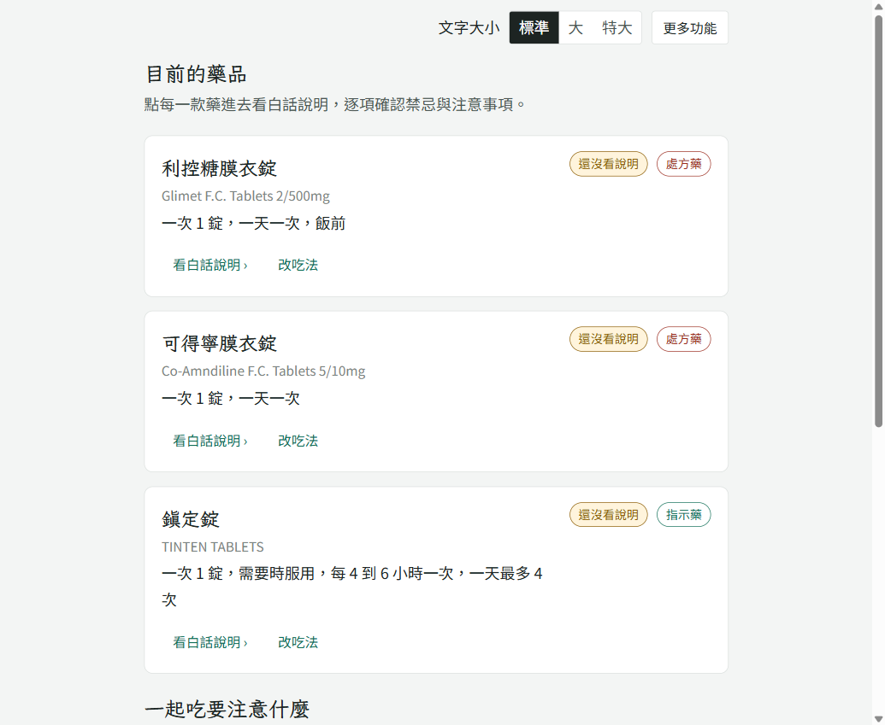

# 藥智通 — 拍一張藥袋，看懂手上的藥

**線上網址：** <https://sean-fang178.github.io/yaozhitong/>

單一 `index.html`（CSS、JavaScript 都寫在檔案裡），用瀏覽器直接開就能操作。
這是「藥智通」用藥助手的靜態示範版：在 GitHub Pages 上沒有後端，所以會改用預載的範例藥袋和仿單資料。
完整版（接 AI 辨識與資料庫）的原始碼在 [yaozhitong-web-demo](https://github.com/Sean-Fang178/yaozhitong-web-demo)。

> ⚠️ 本作品為示範，非醫療器材、非醫療服務，內容僅供衛教參考，不能取代醫師或藥師的專業判斷。



---

## 規格書

### 1. 要解決的問題

一次看診常拿到三、四種藥，但藥袋上只寫藥名和 `1 TAB QD AC` 這種縮寫，仿單又長到沒人看得完。
長輩看不懂就只能自己猜劑量、猜飯前還是飯後；如果在不同科拿到兩種成分重複的藥，也沒有人會提醒。
現有的用藥 App 大多只能查藥名或設鬧鐘，不會確認使用者是不是真的看懂了。

### 2. 目標使用者

- 主要：同時吃好幾種慢性病藥的長輩（範例人物：68 歲王大明，有糖尿病和高血壓）
- 次要：不住在一起、想知道爸媽今天有沒有吃藥的家人

### 3. 使用流程

```
健康調查表 → 上傳藥袋 → 辨識結果確認 → 每款藥的白話說明（逐條確認）
          → 交互作用比對 → 小測驗（全對才通過）→ 每日提醒與打卡
```

### 4. 功能規格

| # | 功能 | 規格 |
| --- | --- | --- |
| 1 | 健康調查表 | 年齡、性別、慢性病、過敏、抽菸／飲酒／檳榔等；必填欄位空白時擋下並列出缺的欄位；之後的說明會依調查表篩選（例：68 歲男性不會被問懷孕哺乳） |
| 2 | 藥袋辨識 | 載入範例藥袋 → 讀出 3 筆藥品的藥名、劑量、頻次、療程；`QD AC` 這類縮寫翻成「一天一次、飯前」；讀不清楚的欄位標「待確認」，可以手動改 |
| 3 | 白話說明 | 把官方仿單改寫成小學生也看得懂的說明，重點用螢光標記；每一條都能展開「對照仿單原文」 |
| 4 | 逐條確認 | 禁忌、飲食、族群警語要一條一條按「已確認」；針對個人的追問（腎功能、顯影劑…）答「是」時給出提醒 |
| 5 | 交互作用 | 每兩款藥比對一次；仿單有寫的附上原文當證據，沒寫的只說「依現有仿單資料未發現記載」，不會說「安全」 |
| 6 | 小測驗 | 每款藥 3 題加交互作用題；答錯會標紅並解釋原因，全部答對才算完成 |
| 7 | 提醒與打卡 | 通過測驗後依吃法排出每天的時段；可以打卡、改時間，看本週服藥紀錄 |
| 8 | 家庭藥箱 | 列出剩藥、過期藥的處理方式；成分重複時跳出提醒 |
| 9 | 用藥問答 | 問跟目前藥品有關的問題（靜態版用關鍵字比對預載的答案） |
| 10 | 無障礙 | 三段字級（標準／大／特大）、朗讀、手機 375px 寬不會出現橫向捲動 |

### 5. 設計原則

1. **一切以官方仿單為依據**：AI 寫的說明旁邊都能點開原文，讓使用者自己對照。
2. **沒有證據就不下結論**：沒查到交互作用時不說「安全」，只說「仿單沒有記載」，避免使用者以為已經查過了。
3. **看懂才放行**：只按「已讀」不算數，要逐條確認、交互作用也看過、測驗全對，才會開始提醒。

### 6. 技術

- 原生 HTML / CSS / JavaScript，不用框架，全部寫在一個 `index.html`
- 資料存在瀏覽器 `localStorage`，重新整理後進度還在；選單裡的「重設示範資料」可以從頭開始
- 預載的三款藥（利控糖、可得寧、鎮定錠）用的是食藥署的真實仿單段落

### 7. 實作過程

跟 AI（Claude）反覆討論需求，再用 Vibe Coding 一步一步做出來。開發時用 Playwright 自動化測試跑了三輪，抓到 26 個問題後逐一修正，例如：

- 不喝酒的人被當成「偶爾飲酒」→ 飲酒改成「否／偶爾／經常」三個選項
- 抽菸、檳榔的數量原本是自由輸入 → 改成區間下拉選單
- 調查表的選項在窄螢幕會斷行 → 縮窄數量下拉選單

## 授權

Apache License 2.0，見 [`LICENSE`](LICENSE)。
